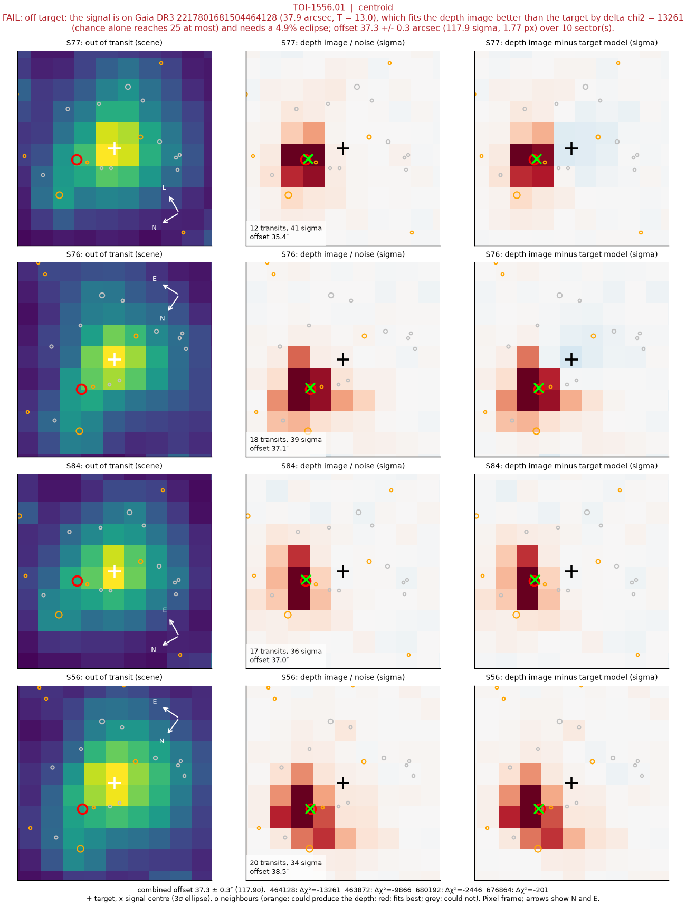
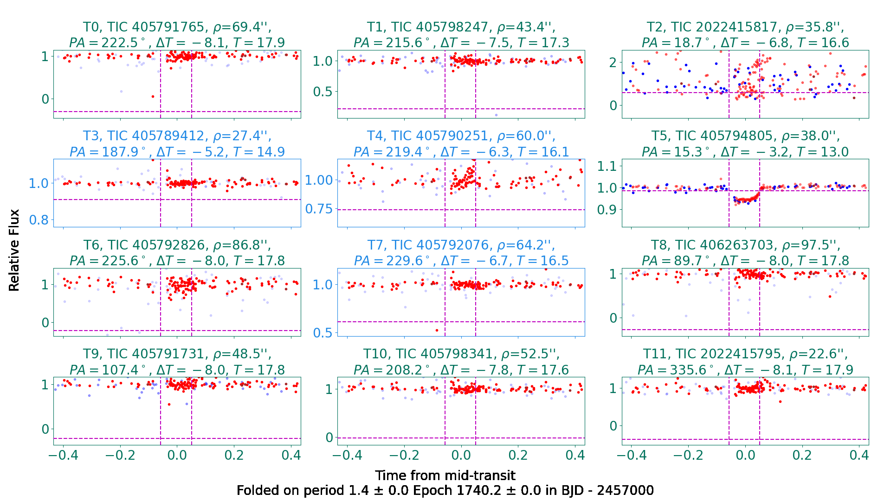

# Worked example: TOI-1556.01, a nearby eclipsing binary

TOI-1556.01 is a 1.44 d, roughly 0.1–0.2% signal on TIC 405794804 (T = 9.8). TFOPWG
has dispositioned it a false positive: a nearby eclipsing binary (NEB). This example
shows PetCare reaching the same answer by three independent routes, ending with
ground-based photometry from ZTF that resolves the culprit.

## Run it

```bash
cd examples/toi1556
./run.sh
```

`data/` holds the tessquicklook light curves for 12 sectors (2 MB). Tiers 0 and 1 use
them directly; tier 2 downloads TESS cutouts on the first run. Tier 3's `pc-archival`
needs DEATHSTAR and an IRSA login for ZTF (see "Accounts and credentials" in the
top-level README); without them it reports INCONCLUSIVE and the rest still runs.

## What it finds

23 tests: 9 PASS, 11 FLAG, 1 FAIL, 2 INCONCLUSIVE (`companion`, until the Sonora grid is
downloaded, and `followup`, which finds nothing bearing on this candidate).

Most of the light-curve tests pass: the dip is box-shaped, odd and even transits match,
the duration fits the star, and there is no secondary eclipse. A blend that dilutes a
deep eclipse down to a shallow one looks like a planet in the light curve alone. The
tests that catch it are the ones that look at *where* the light comes from.

**1. The depth depends on the aperture** (`instrument` FLAG). Per sector, the depth
ranges from 146 to 1658 ppm (chi2 = 344 for 11 dof). A planet's depth does not care which
detector recorded it. A neighbour's contribution does, because how much of it falls in
the aperture changes with the pointing. `crossmatch` sees the same thing between
pipelines: 749 ppm in tessquicklook, 1038 in TESS-SPOC and 2672 in QLP, each with its own
aperture, against errors of 20-30 ppm. It is also why the fit's pooled depth (781 ppm) is lower than the
TOI catalogue's: there is no single depth to measure.

**2. The pixels point at a neighbour** (`centroid` FAIL).



Each row is one sector. In the middle column (where the flux goes missing in transit)
the dip sits on a star 37.9" to the south-west of the target (red circle, green cross),
not on the target (black +). In the right column the target-only model leaves almost
all of the signal behind. Across 10 sectors the offset is 37.3 +/- 0.3" (118 sigma), and
the neighbour fits the depth image better than the target by delta-chi2 = 13261, where
chance alone reaches 25. `pixels` agrees: in every sector where the transit is detected
per pixel, the deepest pixel is off target.

**3. Ground-based photometry resolves it** (`archival`, via
[DEATHSTAR](https://github.com/awmann/DEATHSTAR)).



DEATHSTAR extracts every star in the field from ZTF images, where the pixels are 1"
rather than TESS's 21", and folds each one on the TESS ephemeris. Eleven field stars are
flat. T5, TIC 405794805 at 38", shows a 6.5% flat-bottomed eclipse at 14.8 sigma exactly
where the transit should be. That is the star `centroid` named. The target itself is
too bright for ZTF at T = 9.8 (its folded photometry scatters by tens of percent), so the
ground data cannot test it directly. They don't need to: a 6.5% eclipse on a star that
contributes a few percent of the light in the TESS aperture is enough on its own to
make the TESS signal.

`archival` reports this as a FLAG rather than a FAIL, deliberately. It only FAILs when
the neighbour's eclipse is at least 20% deep, because shallower than that its scan
does not reliably rank the right star first. Here the eclipse is shallower, but
`centroid` named the same star from the TESS pixels, so the two tests agree independently.

## Reading it

No single test kills this candidate, and no test needs to. The light-curve tests say it
looks like a transit, and that is all they can say. `instrument` and `crossmatch` say
the depth depends on the aperture, `centroid` says which star the light is coming from,
and ZTF, with pixels small enough to separate the two, shows that star eclipsing. Read
together, they make a stronger case than any one of them alone.
